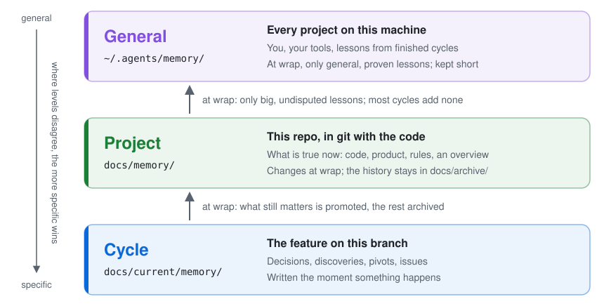

<p align="center">
  <picture>
    <source media="(prefers-color-scheme: dark)" srcset="docs/logo-dark.svg">
    
  </picture>
</p>

> project-time is a workflow for AI coding agents. It takes a new project or
> a single feature through spec, plan, build and wrap, stops at gates for your
> approval, and keeps a memory of decisions, discoveries and pivots in your
> repo. After a context reset, or a switch from Claude Code to Codex, type
> `/project-time` (`$project-time` in Codex) and the work picks up where it
> stopped.

[](CHANGELOG.md)
[](LICENSE)
[](#the-five-skills)
[](#install)

<p align="center">
  
</p>

<p align="center"><sub>A new session in a small demo repo (wordfreq, a word counter) picks up at step 02, builds it tests first, and stops at the milestone gate. Sped up 2.5 times after the first 14 seconds.</sub></p>

## Why project-time

A long feature outlives the agent's context window. The plan sits in a chat
that's gone after a compaction, and the reasons behind last week's decision are
written nowhere. project-time puts the whole state of the work in plain files in
the repo, and gives the agent a process that keeps them up to date.

- **It survives context resets.** Progress is written to disk before and after
  every step. On resume the agent checks the plan's progress board against
  `git log` and the working tree, then continues from the exact step, or stops
  and asks when they disagree. It never discards uncommitted work.

- **You decide at the gates.** The spec comes from an interview, one question
  per message with a recommended option first, and every settled behaviour gets
  an acceptance criterion a test can check. The build starts only after you
  approve the spec, and it waits at each milestone gate until you approve it or
  ask it to run through. The workflow never pushes or merges.

- **Every step can run on its own.** Milestones are vertical slices, the first
  one a walking skeleton. Each step is a file with the tests to write first, a
  verify command and its dependencies, so a fresh session or a sub-agent in its
  own git worktree can run it from the file alone. Steps that share nothing run
  in parallel.

- **Tests decide when a step is done.** Each test is seen failing before the code is
  written, and the verify command's output is quoted in the conversation. After
  three attempts on different hypotheses, a failing step is marked blocked with
  a record of what was tried.

- **Decisions keep their reasons.** Each decision is recorded with the why and
  the options rejected. A pivot supersedes the old entry and leaves it in place,
  so you can still read the first decision and what changed it. At wrap, what
  holds beyond the feature moves up to [project or general memory](#memory).

## When to use it

Use it for work that takes more than one session: a new project, or a feature
with real decisions in it.

Skip it for a one-line fix, a quick question or a throwaway script, where writing
a spec and a plan would take longer than the work itself.

## How it works

```
 spec ──────▶ plan ──────▶ build ─────────▶ wrap
 interview    milestones   step by step     final gate
 Gate 0       Gate 1       gate after       recap
                           each milestone   memory moves up
                                            archive
```

Every piece of work is a **cycle**: the first build of a new project, or a
feature on its own branch. You type `/project-time` and it reads the state on
disk, then hands off to the skill that owns it. Typing it again after a reset,
a day later or in another agent picks up the same cycle.

What ends up in your repo:

```
AGENTS.md                 standing rules for any agent (a marked block, versioned)
CLAUDE.md                 imports AGENTS.md for Claude Code
.claude/settings.json     Claude Code auto-memory off, so each fact has one home
docs/
├── memory/               project memory: INDEX.md, overview.md, area files
├── current/              the active cycle
│   ├── spec.md
│   ├── plan/             INDEX.md progress board, step-NN-*.md
│   ├── memory/           cycle memory
│   └── recap.md
└── archive/              finished cycles, one folder each
```

## Memory

project-time keeps three levels of memory, from the most specific to the most
general. **Cycle** memory, in `docs/current/memory/`, belongs to the feature
being built on this branch: the agent writes down a decision, a discovery, a
pivot or an issue the moment it happens. **Project** memory, in `docs/memory/`,
holds what is true for the whole repo and lives in git with the code. It changes
only when a cycle wraps, which promotes the cycle entries that still matter and
rewrites a one-page overview. **General** memory, in `~/.agents/memory/`, sits
outside any repo and is read in every project: facts about you, your tools, and
lessons from finished cycles, each added with your approval. Every
session reads the index of all three, and where they disagree the more specific
level wins.

<p align="center">
  <picture>
    <source media="(prefers-color-scheme: dark)" srcset="docs/memory-dark.svg">
    
  </picture>
</p>

## See an example

[`examples/wall-dimensions`](examples/wall-dimensions) is a short cycle for a
floor-plan editor, based on a real one and simplified to fit on a few screens.
One feature is built in five steps, and a change of mind at the final gate
supersedes a decision from the spec. The example's README follows that change
through the spec, the plan and the memory, and shows sample entries at all three
memory levels.

<p align="center">
  <a href="examples/wall-dimensions"></a>
</p>

## The five skills

| Skill | Owns |
|---|---|
| [project-time](./project-time) | Entry point. Sets the repo up on first run (`docs/`, the `AGENTS.md` block, the general memory, auto-memory off) and routes to the phase that owns the current state. |
| [project-spec](./project-spec) | The interview, the spec, Gate 0, and amend mode for changing an approved spec mid-build. |
| [project-plan](./project-plan) | Milestones, step files, parallel-safe groups, Gate 1, and update mode after a pivot. |
| [project-build](./project-build) | The step loop: resume, tests first, verify, memory checkpoint, commit. Milestone gates and parallel runs. |
| [project-wrap](./project-wrap) | Final gate, recap, memory consolidation and promotion, archive. Also writes interim recaps. |

## Support

| Agent | Status |
| --- | --- |
| Claude Code | Supported. Phases hand off through the Skill tool, so they survive compaction. |
| Codex | Supported. Type `$project-time`. Reads the `AGENTS.md` block; phases hand off by reading the next skill's `SKILL.md`. |
| Cursor, Gemini CLI, GitHub Copilot, OpenCode | The installer sets them up; not tested yet. |

Needs git (the workflow offers `git init` if the folder isn't a repo) and Node,
for `npx`.

Codex's default `workspace-write` sandbox keeps `.git` read-only, so the
workflow can't commit. Add the repo's `.git` folder to the writable roots, for
example in `~/.codex/config.toml`:

```toml
[sandbox_workspace_write]
writable_roots = ["/path/to/your/repo/.git"]
```

## Install

With the [`skills`](https://github.com/vercel-labs/skills) CLI, all five at once:

```bash
npx skills add paull78/project-time --skill '*' --global
```

To install for several agents from one shared copy:

```bash
npx skills add paull78/project-time --skill '*' -g -y --agent claude-code codex
```

Then, in any repo:

```
/project-time
```

In Codex, type `$project-time` instead.

The first run sets the repo up and starts a cycle. Later runs continue it.

### What setup changes

In the repo, committed as `project-time: setup`:

- a marked block in `AGENTS.md` (created if missing), and `@AGENTS.md` in `CLAUDE.md`;
- `docs/memory/` with an index and an empty overview;
- `"autoMemoryEnabled": false` in `.claude/settings.json`. If Claude Code's
  auto-memory folder for this repo already holds entries, setup shows them,
  proposes a home for each in the three levels, and empties the folder once you
  approve.

Outside the repo, never committed:

- `~/.agents/memory/INDEX.md`, the general memory, created if missing;
- the line `@~/.agents/memory/INDEX.md` in `~/.claude/CLAUDE.md`, so Claude Code
  reads the general memory in every session.

The workflow commits on your branch as it goes, and never pushes or merges.

## Works well with

These live in [paull78/skills](https://github.com/paull78/skills) and are optional:

- the `knowledge-*` lenses (Clean Architecture, Simple Made Easy, The Pragmatic
  Programmer and others), offered in the spec's challenge round;
- `human-write-time`, which `project-wrap` follows when it writes the recap;
- `instrument-time`, suggested when a step's verify keeps failing.

## Testing the skills

[`tools/scenarios`](tools/scenarios) holds scripted runs of the workflow through
headless `claude -p`, in throwaway git repos: setup, spec, plan, build, resume,
pivot, parallel steps, wrap, a feature cycle and two branches. Each script prints
`PASS:` lines or stops at the first `FAIL:`. Runs are slow and cost tokens; the
[scenarios README](tools/scenarios/README.md) has the details.

## License

[MIT](LICENSE)
