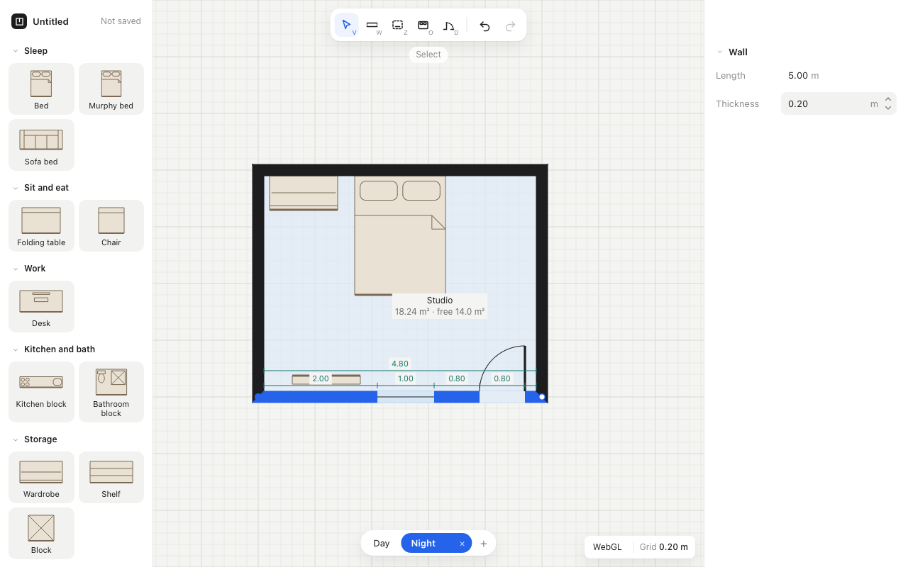

# Example: wall dimensions

A short, illustrative cycle. It's based on a real cycle in [Flatmate](https://github.com/paull78/flatmate), a floor-plan editor, cut down to one feature and simplified so that each file fits on a screen.

The feature: a selected wall shows its length, split at its doors and windows, and the user can type a new value into any piece.

<p align="center">
  
</p>

## The cycle

```
spec    interview, decision .02: measure along the centre line      Gate 0
plan    2 milestones, 3 steps (01 ∥ 02)                             Gate 1
build   Milestone 1 → gate, Milestone 2 → gate
        discovery .04 at step 01: faces end cleanly at corners
wrap    final gate: "dimension should not start mid wall"
        pivot .06 supersedes .02 → spec amended, Milestone 3 built
        recap, memory moves up, cycle archived
```

## The files

| File | In a real repo | What it shows |
|---|---|---|
| [spec.md](spec.md) | `docs/current/spec.md` | Goal, scope, behaviour, acceptance criteria, and one amendment with struck criteria |
| [plan/INDEX.md](plan/INDEX.md) | `docs/current/plan/INDEX.md` | The progress board: milestones, steps with what they need, `∥` for parallel steps, gate dates |
| [plan/step-01-domain-wall-chain.md](plan/step-01-domain-wall-chain.md) | `docs/current/plan/` | One step: tests to write first, a verify command, done when |
| [memory/cycle/](memory/cycle/) | `docs/current/memory/` | Cycle memory: a pin in the INDEX, and one entry of each kind (decision, discovery, issue, pivot) |
| [recap.md](recap.md) | `docs/current/recap.md` | The cycle told for people, citing memory IDs |
| [moved-up.md](moved-up.md) | | Where each cycle entry went at wrap |
| [memory/project/](memory/project/) | `docs/memory/` | Project memory after the wrap: the promoted entries, IDs unchanged |
| [memory/general/](memory/general/) | `~/.agents/memory/` | General memory after the wrap: a pin and the two new lessons |

## Follow the change of mind

1. At the spec, [wall-dims.02](memory/cycle/dimensions.md) chooses the centre line and records why the clear interior option was rejected.
2. During the build, [wall-dims.04](memory/cycle/dimensions.md) notes that faces end cleanly at corners, which answers that objection.
3. At the final gate the user asks for clear space. The pivot [wall-dims.06](memory/cycle/dimensions.md) supersedes .02, which stays in place with a link to .06.
4. The [spec](spec.md) strikes AC-02 and adds AC-05 and AC-06. The [plan](plan/INDEX.md) gets Milestone 3, and the done steps stay as they were.
5. At wrap, .06 moves up to [project memory](memory/project/domain.md) with its ID, and the takeaway becomes a [lesson for every project](memory/general/lessons.md).
